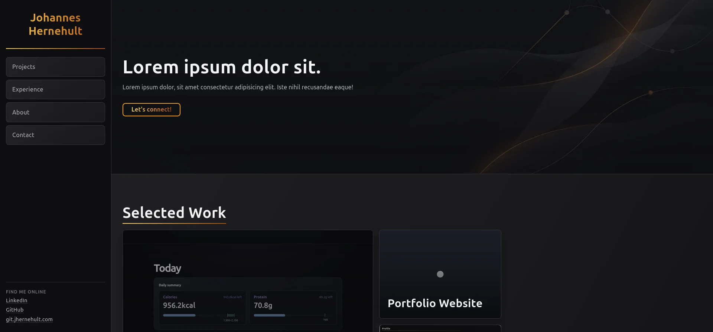
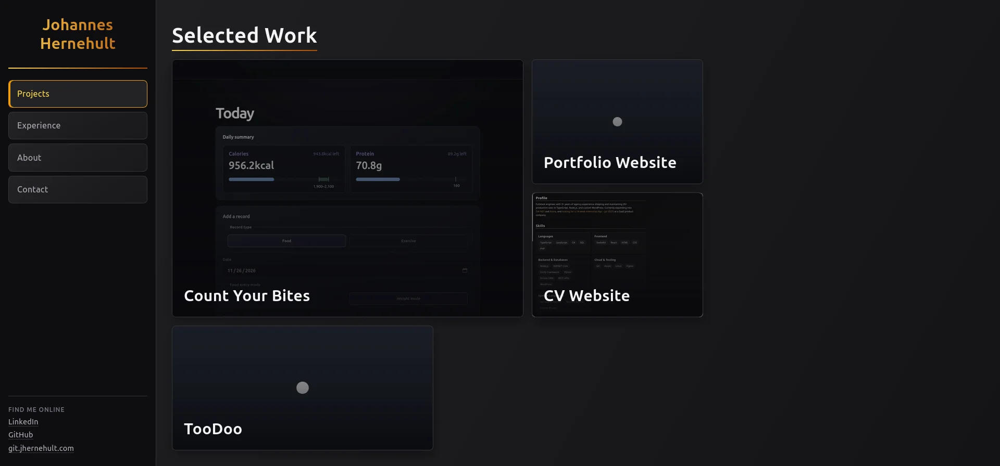
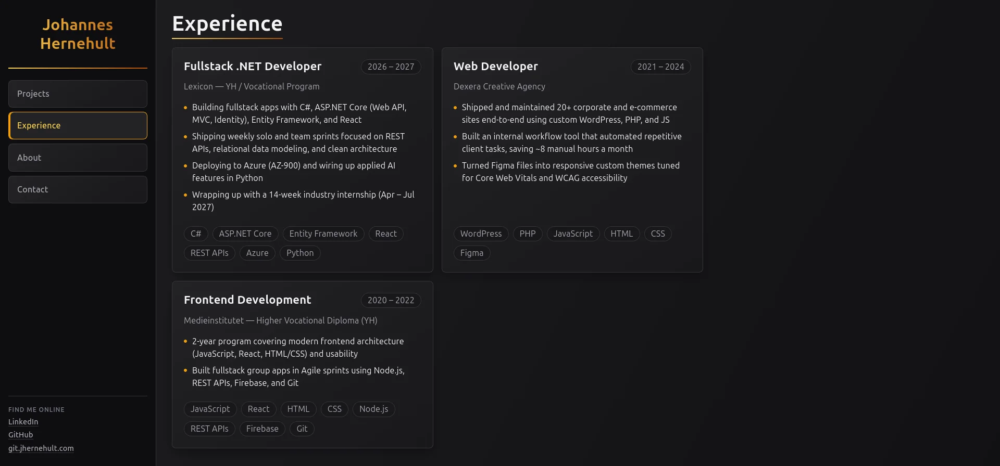
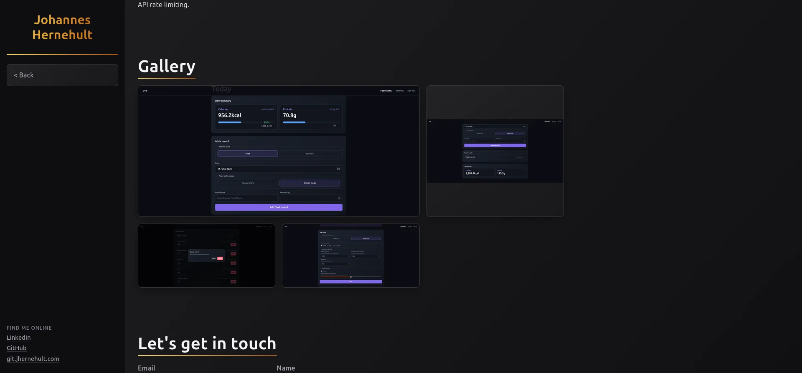

# Johannes Hernehult — Portfolio Website

Personal developer portfolio showcasing selected projects, work and education history, background, and a direct contact form. Built with React, TypeScript, React Router, and CSS Modules on top of a custom design-token stylesheet with zero third-party UI libraries.

**Live site:** [jhernehult.com](https://jhernehult.com/)

---

## Screenshots

| Home Hero                                                   | Projects Grid                                                       |
| ----------------------------------------------------------- | ------------------------------------------------------------------- |
|  |  |

| Experience & About                                                       | Project Detail & Lightbox Gallery                                                 |
| ------------------------------------------------------------------------ | --------------------------------------------------------------------------------- |
|  |  |

---

## Features

- **Responsive Navigation Shell:** Fixed left sidebar (`300px`) on desktop that transitions into a sticky top header below `900px`, swapping between section links (`MainNav`) and history-aware back navigation (`ProjectNav`).
- **Bento-Style Project Grid:** Dense 12-column CSS Grid supporting default (`4-col`), `wide` (`6-col`), `tall` (`4-col × 2-row`), and `large` (`8-col × 2-row`) project cards.
- **Project Case Studies & Lightbox:** Dedicated `/project/:slug` pages with live/repo links, tech tags, project overview, and a responsive screenshot gallery backed by a native `<dialog>` lightbox on viewports wider than `600px`.
- **Scroll-Spy & Scroll Restoration:** Smooth hash navigation with active section highlighting and `sessionStorage`-backed scroll position restoration when navigating back from project pages.
- **Contact Form:** Asynchronous email delivery powered by EmailJS with live accessible status feedback (`role="status"`, `aria-live="polite"`).
- **Accessibility & Motion Support:** Keyboard-navigable controls, `:focus-visible` outlines, semantic landmarks, and global `prefers-reduced-motion` handling.

---

## Tech Stack

- **Framework & Language:** React, TypeScript
- **Routing:** React Router (`react-router`)
- **Styling:** CSS Modules (`*.module.css`) + custom CSS properties (`src/index.css`)
- **Build Tool:** Vite
- **Email Delivery:** EmailJS (`@emailjs/browser`)

---

## Folder Structure

```text
├── public/
│   └── images/                     # Portrait, hero background, and project screenshots
└── src/
    ├── App.css                     # App shell layout (main, content-section, footer)
    ├── App.tsx                     # Top-level layout and scroll-on-navigate hook
    ├── index.css                   # CSS reset, design tokens, typography, shared primitives
    ├── main.tsx                    # React root mount with BrowserRouter
    ├── vite-env.d.ts               # Vite environment variable typings
    └── features/
        ├── home/
        │   ├── Home.tsx            # Home page section composition
        │   ├── index.ts
        │   └── sections/
        │       ├── about/          # Bio and portrait
        │       ├── experience/     # Education and work history cards
        │       ├── hero/           # Landing hero and mobile social links
        │       └── projects/       # 12-column project card grid
        ├── project/
        │   ├── Project.tsx         # Dynamic /project/:slug page
        │   ├── index.ts
        │   └── sections/
        │       ├── gallery/        # Screenshot grid + useGalleryLightbox (<dialog>)
        │       ├── hero/           # Project title, summary, links, and tags
        │       └── overview/       # Multi-paragraph project write-up
        └── shared/
            ├── types.ts            # Project and Experience TypeScript definitions
            ├── components/
            │   ├── app-routes/     # Route definitions with lazy-loaded Project route
            │   ├── contact/        # Contact form + EmailJS service wrapper
            │   ├── footer/         # Dynamic copyright footer
            │   ├── header/         # Sidebar/sticky header + MainNav & ProjectNav
            │   ├── not-found/      # 404 fallback view
            │   └── social-links/   # LinkedIn, GitHub, and self-hosted Git links
            ├── data/
            │   ├── experiences.ts  # Structured experience entries
            │   └── projects.ts     # Structured project entries, links, and image metadata
            ├── hooks/
            │   ├── getActiveSectionId.ts   # Pure scroll-spy section calculation
            │   ├── useActiveSection.ts     # Viewport section observer with rAF throttling
            │   ├── useMediaQuery.ts        # matchMedia hook via useSyncExternalStore
            │   ├── useScrollLock.ts        # Body/root scroll lock for modal dialogs
            │   └── useScrollOnNavigate.ts  # Hash scrolling & sessionStorage scroll restore
            └── lib/
                └── loadProjectPage.ts      # Shared dynamic import for lazy loading & prefetch
```

---

## Architecture

- **Feature-Based Modules:** UI sections, styles, and feature-specific hooks live together under `src/features/home`, `src/features/project`, and `src/features/shared`, exposing clean entry points via `index.ts` barrel files.
- **Token-Driven Styling:** `src/index.css` defines all color tokens (`--color-*`, `--accent-hsl`), spacing steps (`--size-3xs` through `--size-3xl`), radii, shadows, and reusable classes (`.btn`, `.page-hero`, `.pill`, `.surface-card`). Component-specific layout and states stay isolated in co-located CSS Modules.
- **Code Splitting & Intent Prefetching:** `AppRoutes` lazy-loads the `/project/:slug` view using `React.lazy` and `Suspense`. `Projects.tsx` calls the same `loadProjectPage()` dynamic import on `pointerenter` and `focus`, warming the chunk before navigation occurs.
- **Decoupled Scroll & Lightbox Logic:** Complex DOM interactions—scroll-spy threshold math (`getActiveSectionId`), history scroll restoration (`useScrollOnNavigate`), and `<dialog>` keyboard/backdrop handling (`useGalleryLightbox`)—are extracted into focused hooks outside JSX components.

---

## Getting Started

### Prerequisites

- **Node.js** (v20 or newer recommended)
- **npm** (or compatible package manager)

### Installation

1. Clone the repository:

   ```bash
   git clone https://github.com/johannes-hernehult/portfolio-site.git
   cd portfolio-site
   ```

2. Install dependencies:

   ```bash
   npm install
   ```

3. Create a `.env` file in the project root and add your EmailJS credentials (used by `src/features/shared/components/contact/emailService.ts`):

   ```env
   VITE_EMAILJS_SERVICE_ID=your_service_id
   VITE_EMAILJS_TEMPLATE_ID=your_template_id
   VITE_EMAILJS_PUBLIC_KEY=your_public_key
   ```

4. Start the development server:
   ```bash
   npm run dev
   ```

### Available Scripts

| Command           | Description                                                  |
| ----------------- | ------------------------------------------------------------ |
| `npm run dev`     | Starts the local Vite development server                     |
| `npm run build`   | Builds the production bundle into `dist/`                    |
| `npm run preview` | Serves the production `dist/` build locally for verification |

---

## Customizing Content

- **Projects:** Edit `src/features/shared/data/projects.ts` and place corresponding images in `public/images/projects/`.
- **Experience:** Edit `src/features/shared/data/experiences.ts`.
- **Social Links:** Update the `profiles` array in `src/features/shared/components/social-links/SocialLinks.tsx`.
- **Bio & Portrait:** Update `src/features/home/sections/about/About.tsx` and `public/images/johannes-hernehult.webp`.
